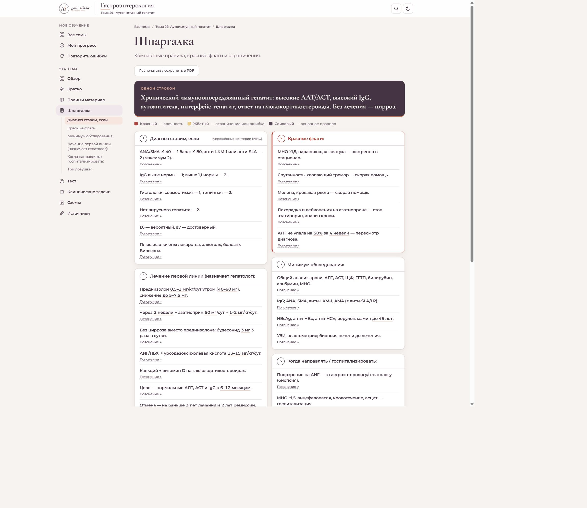
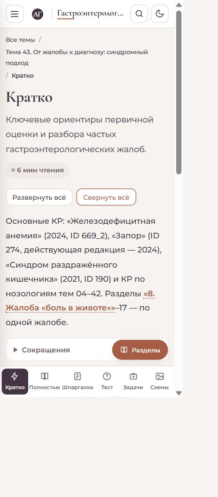

# Выборочная проверка в браузере

27 октября 2026 года. Проверялся окончательный локальный сайт через HTTP.

- Тема 3: обзор → краткий материал → тест → клинические задачи → возврат «Назад». Шапка и меню сохраняют узлы доступности; меняется содержимое основной области. Семь частей сворачиваются. Ответ теста проверяется с разбором и сохраняется при возврате. Все три этапа клинической задачи открываются.
- Тема 25: блок вопросов без ключей раскрывается; сохранены вопросы 21–100 с вариантами и пояснением об отсутствии автоматической оценки.
- Тема 29: карточка содержит диагностические критерии и исходную подсказку в заголовке; «Пояснение» ведёт к разделу 8 полного материала. Проверены поиск IgG, светлая/тёмная тема, галерея, увеличение схемы и источники. Ошибок в консоли не обнаружено.
- Тема 43: при эффективном размере окна 390 × 843 CSS-пикселя проверены семь тематических групп, сворачивание, боковое меню и переходы через нижнюю панель. Горизонтального переполнения страницы нет.

Проверка в браузере выборочная; все 41 темы отдельно прошли автоматическое сравнение сохранности текста и структуры. Клиническое содержание не редактировалось и в рамках этой задачи не проверялось.

